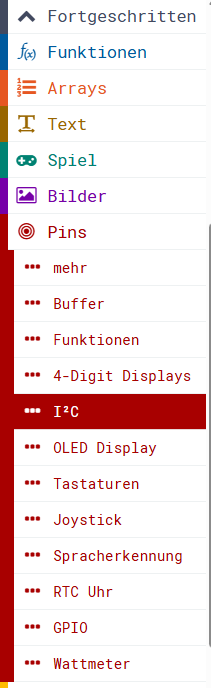

> Diese Seite bei [https://calliope-net.github.io/pins/](https://calliope-net.github.io/pins/) öffnen

### Calliope Erweiterung für Pins: viele externe Module programmieren.

Die Erweiterung für den vorhandenen Menüpunkt *Pins* enthält Blöcke für viele externe Module gleichzeitig.
Durch Beschränkung auf Grundfunktionen bleibt die Anzahl der Blöcke übersichtlich.
> Für mehr Funktionen gibt es zu jedem Modul eine eigene Erweiterung.

## Als Erweiterung verwenden 

Dieses Repository kann als **Erweiterung** in MakeCode hinzugefügt werden.

* öffne Makecode in der App oder die Webseite [https://makecode.calliope.cc/](https://makecode.calliope.cc/)
* klicke auf **Neues Projekt** und gib deinem Projekt einen Namen
* wähle die zu deinem Calliope mini passende Hardware v1, v2 oder v3
* klicke auf **Erweiterungen**
* schreibe die folgende **Projekt-URL**:
* **calliope-net/pins**
* mit der Tastatur oben in das weiße Feld und klicke auf ENTER
* klicke auf das Rechteck **pins** (kann von der Tastatur verdeckt sein)
* jetzt sind unter dem Menüpunkt *Fortgeschritten - Pins* neue Einträge:

## Blöcke und Parameter

### Pins

#### ... mehr

#### ... Buffer

#### ... Funktionen

#### ... 4-Digit Displays

#### ... I²C

#### ... OLED Display

#### ... Tastaturen

#### ... Joystick

#### ... Spracherkennung

#### ... RTC Uhr
→ RTC: real-time clock → [de.wikipedia.org/wiki/Echtzeituhr](https://de.wikipedia.org/wiki/Echtzeituhr)
###### [Grove - High Precision RTC (Real Time Clock)](https://wiki.seeedstudio.com/Grove_High_Precision_RTC)

##### Uhr lesen

Block **Datum und Zeit einlesen**
* <ins>Muss am Anfang jeder Schleife aufgerufen werden.</ins>
* Liest 7 Byte in eine interne Variable (Buffer).

> <ins>Die folgenden Blöcke lesen nur die interne Variable, nicht die Uhr.</ins>

Block **`0 Sekunde` als Zahl** : Byte
* Liest 1 Byte aus der internen Variable BCD zu dezimal konvertiert.
* Es gibt 7 *Register* 0 bis 6:
  * `0` Sekunde `ss` 00..59
  * `1` Minute `mm` 00..59
  * `2` Stunde `HH` 00..23
  * `3` Tag `dd` 01..31
  * `4` Wochentag `ddd` So Mo Di Mi Do Fr Sa (00..06)
  * `5` Monat `MM` 01..12
  * `6` Jahr `yy` 00..99

Block **`Datum dd.MM.yy`** : String
* gibt als Text (String) zurück:
  * Datum dd.MM.yy
  * Datum dd.MM.20yy
  * Datum dd.MM
  * Wochentag ddd (2 Zeichen So Mo ..)
  * Zeit HH:mm
  * Zeit HH:mm:ss
  * Zeit mm:ss
  * yyMMddHHmmss (12 Zeichen)

Block **zeige `Zeit Hmmss` binär in 25 LED Matrix**

* Zeigt in den 5 Spalten der LED Matrix Zeit oder Datum an.
* Von den leuchtenden roten LEDs die Binärzahlen addieren.

`Zeit Hmmss`

|0|1|2|3|4|Binärzahl
|---|---|---|---|---|---
|H| | | | |2^4=16
|H| |m| |s|2^3=8
|H|m|m|s|s|2^2=4
|H|m|m|s|s|2^1=2
|H|m|m|s|s|2^0=1

`Datum wdMyy` (Wochentag 0..6, Tag 0..31, Monat 1..12, Jahr Zehner 0_..9_, Jahr Einer _0.._9)

|0|1|2|3|4|Binärzahl
|---|---|---|---|---|---
| |d| | | |2^4=16
| |d|M|y|y|2^3=8
|w|d|M|y|y|2^2=4
|w|d|M|y|y|2^1=2
|w|d|M|y|y|2^0=1

Block **Buffer (7Byte) [s,m,H,d,w,M,y] im Format BCD** : Buffer

* Gibt die interne Variable (Buffer) zurück. 7 Byte Index=Register `0`..`6`.
* Jedes Byte ist BCD codiert (binär codierte Dezimalzahl).
* 4 Bit pro Ziffer, Bit `7654` Zehner, Bit `3210` Einer, Jahr 2-stellig
* Formel zum Umrechnen: `(rtc_Buffer[register] >> 4) * 10 + (rtc_Buffer[register] & 0x0F)`

Block **oscillator stop** : Boolean
* Gibt True zurück, wenn die Uhr neu gestellt werden muss.
* Kann bedeuten, dass die Knopfzelle gewechselt werden muss.

##### Uhr stellen

Block **Uhr stellen 1 Zeichencode** (ascii_code) : String
* Stellt die Uhr mit 5 ASCII Zeichen-Codes von Keypad oder Keyboard.
* erlaubte Codes: 42=* 48=0 49=1 50=2 51=3 52=4 53=5 54=6 55=7 56=8 57=9 35=# 13=ENTER
* Muss 5 mal mit ASCII Code aufgerufen werden, gibt den zusammengesetzten String zurück.\
  *1. Zeichen:* `*` neue Eingabe beginnen\
  *2. Zeichen:* Register Nummer `0..6`\
  *3. und 4. Zeichen:* Zahl, die in das Register geschrieben wird: 2 Ziffern dezimal `00..59`\
  *5. Zeichen:* `#` speichern (ascii_code=35 oder ENTER=13)
* Wenn 5 Zeichen gültig sind, wird mit dem folgenden Block das Register geändert.
* Beispiele:
  * `*120#`setzt Minute auf 20
  * `*401#` Montag
  * `*000#` Sekunde 0

Block **Uhr stellen 5 Zeichen** (*000#)
* 

Block **rtc_write** (index, int8)
* Stellt die Uhr. Ändert ein bestimmtes Register *index*.
* `0`Seconds, `1`Minutes, `2`Hours, `3`Days, `4`Weekdays, `5`Months, `6`Years
* *int8*: 0..59 Byte wird in BCD konvertiert und im RTC-Modul gespeichert. 

#### ... GPIO

#### ... Wattmeter

## Dieses Projekt bearbeiten 

Um dieses Repository in MakeCode zu bearbeiten.

* öffne [https://makecode.calliope.cc/](https://makecode.calliope.cc/)
* klicke auf **Importieren** und dann auf **Importiere URL**
* füge **https://github.com/calliope-net/pins** ein und klicke auf Importieren

## Blocks preview

This image shows the blocks code from the last commit in master.
This image may take a few minutes to refresh.

#### Metadaten (verwendet für Suche, Rendering)

* for PXT/calliopemini

